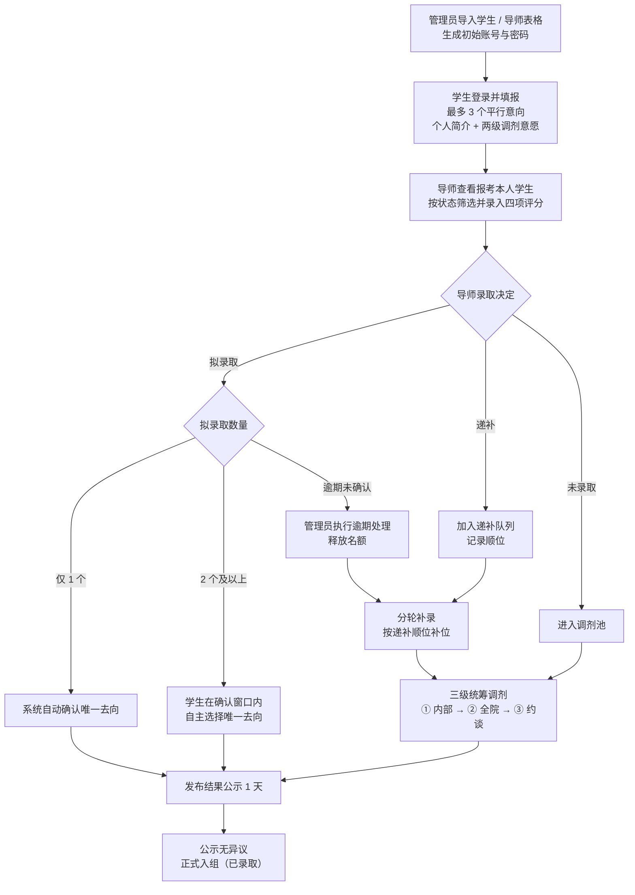

# 01 用户旅程与原子用户故事

> 文档定位：本文档只描述「学生实训室进组选拔系统」的角色旅程、原子用户故事与范围边界，作为后续数据库设计、接口设计与前端页面设计的输入。
>
> 现状基线：仓库中的 `frontend/` 已用前端 mock 实现完整演示版，路由、状态与文案均可在代码中核对。本文档不新增页面、不新增接口、不修改代码。
>
> 关联代码：`frontend/src/router/index.js`、`frontend/src/api/index.js`、`frontend/src/mock/server.js`、`frontend/src/mock/seed.js`、`frontend/src/views/`。

## 一、角色定义

| 角色 | 身份说明 | 登录方式 | 登录后默认入口 |
| --- | --- | --- | --- |
| 游客 | 未登录访问者，仅可浏览公开信息 | 无需登录 | `/` 首页、`/rooms` 实训室介绍 |
| 学生 | 参与进组选拔的在校学生 | 学号 + 管理员分配的初始密码（如 `S2026001`） | `/student/status` 录取状态 |
| 导师 | 负责面试考核与录取决定的实训室导师 | 工号 + 管理员分配的初始密码（如 `T1001`） | `/teacher/applicants` 报考学生与考核 |
| 管理员 | 学院侧统筹人员，负责建号、日程、录取统筹、调剂与公示 | 账号 `admin` + 密码 | `/admin/import` 导入账号 |

角色边界由后端接口统一校验：各接口在路由表中声明允许角色，非授权角色请求返回 `403`；未携带有效令牌返回 `401`。

## 二、端到端用户旅程地图

### 2.1 游客旅程

| 阶段 | 用户目标 | 触点页面 | 关键操作 | 系统反馈 | 数据落库点 |
| --- | --- | --- | --- | --- | --- |
| 首页与流程总览 | 快速了解本次选拔有哪些环节、当前进行到哪一步 | `/`（Home.vue） | 浏览 Hero 区、7 步流程总览、实训室速览、意向填报窗口状态 | 每个流程步骤显示「进行中 / 未开始 / 已结束」徽标；Hero 统计展示实训室数量、名额总数、进行中步骤数与填报窗口状态 | 只读查询 `schedules`、`rooms`、`notices`、`intentions` 聚合结果，不写入 |
| 实训室介绍 | 了解各实训室方向、名额、培养安排与考核方式，判断是否值得报名 | `/rooms`（Rooms.vue） | 浏览实训室卡片、方向标签、招收名额、剩余名额、导师人数、培养安排、考核方式、简介 | 剩余名额大于 0 显示「剩余 N 个名额」，为 0 显示「已招满」；空数据时展示空态文案 | 只读 `rooms` 与 `teachers` 聚合结果，不写入 |
| 公告 | 获取报名时间、面试安排、调剂规则等官方信息 | `/` 首页「重要通知」区（系统没有独立公告页） | 阅读标题、级别、正文与发布时间 | 按发布时间倒序展示；级别以「重要 / 提醒 / 普通」徽标区分 | 只读 `notices`，不写入 |
| 登录入口 | 进入与自己身份匹配的工作台 | `/login`（Login.vue） | 输入账号密码，或点击演示账号一键填充；可点击「重置演示数据」 | 登录成功写入登录态并按角色跳转；失败在表单内提示 `[401] 账号或密码错误`；演示账号区支持加载失败重试与空态提示 | 登录成功写入 `sessions`；重置演示数据重建 `seed` 数据并清空当前登录态 |

### 2.2 学生旅程

| 阶段 | 用户目标 | 触点页面 | 关键操作 | 系统反馈 | 数据落库点 |
| --- | --- | --- | --- | --- | --- |
| 1. 登录 | 以学生身份进入选拔系统 | `/login` | 输入学号与初始密码；或点击演示账号快速填充 | 成功跳转 `/student/status` 或 `redirect` 指定页面；失败显示 `401` 文案；刷新后登录态从 `localStorage` 恢复 | `sessions`（令牌、角色、用户 ID） |
| 2. 意向填报 | 在填报窗口内争取最多 3 个平行意向的面试机会 | `/student/intent`（Intent.vue） | 选择第一/第二/第三意向导师（可只填 1 个，不可重复）；填写不少于 20 字的个人简介；勾选「服从实训室内部调剂」与「服从全院跨实训室调剂」；提交意向 | 顶部显示填报窗口「进行中 / 未开始 / 已结束」；提交成功后展示只读的已提交意向表、简介与调剂意愿；窗口关闭提交返回 `410`，少于 1 个/超过 3 个/重复导师/简介不足 20 字/重复提交返回 `422` | `intentions`：每位学生最多 3 条首轮记录，写入 `priority`（1~3）、`round=1`、`status=待面试`、`intro`、`acceptInnerAdjust`、`acceptGlobalAdjust`、教师与实训室快照；`logs` 记录提交动作 |
| 3. 等待第一次录取结果 | 了解每条意向是否通过面试、是否拟录取或递补 | `/student/status`（Status.vue） | 查看意向数、拟录取数、递补状态、确认状态四张指标卡；查看意向明细中的面试总分、递补顺位与简介 | 意向列表实时反映导师评分与录取结果；面试未完成显示「—」；简介超过 40 字可展开/收起；加载失败可重试 | 只读 `intentions`、`interviews`、`confirmations`；状态由导师决策写入 |
| 4. 拟录取确认 | 锁定唯一去向，避免名额悬空 | `/student/status` | 仅收到 1 个拟录取时无需操作，系统自动确认；收到 2 个及以上时，在确认窗口内单选一个去向并点击「确认唯一去向」 | 1 个拟录取显示「系统已自动确认」；2 个及以上显示确认倒计时与待确认徽标；确认成功后其余拟录取自动转「已放弃」且不可撤销；窗口关闭后点击确认返回 `410`；重复确认/已放弃/已录取/状态不符返回 `422`；操作他人意向返回 `403` | `confirmations` 写入 `mode=auto`（单一自动）、`mode=manual`（学生自主）、`mode=giveup`（其余自动放弃）、`mode=expired`（逾期处理）；`intentions` 状态同步为 `已确认` / `已放弃` |
| 5. 查看递补 | 判断自己是否还有补录机会 | `/student/status`、`/student/final` | 查看递补徽标与「第 N 顺位」，结合最终结果页的「递补中」阶段提示 | 递补显示顺位；名额释放后由管理员补录，状态自动转为拟录取或已确认 | `intentions.status=递补` 与 `rank`；补录时 `adjustments` 写入 `type=supplement`，`intentions` 状态更新 |
| 6. 调剂与补录结果 | 了解未录取后是否被调剂、调剂到哪个实训室与导师 | `/student/adjustment`（Adjustment.vue）、`/student/final` | 查看是否进入调剂池、两级调剂意愿、三级调剂优先级说明与每条调剂记录；在最终结果页查看调剂与补录记录 | 未录取且服从调剂时显示「已进入调剂流程」；记录按时间倒序展示原实训室、调剂去向与结果；无记录时展示空态说明 | `adjustments`：`type=inner/global/supplement/interview`、`round=2`、原实训室、新实训室、新导师、结果文案、时间；调剂成功时 `intentions` 新增 `round=2` 记录并可能自动确认 |
| 7. 查看最终公示 | 确认自己最终是否被正式录取 | `/student/final`（Final.vue） | 查看阶段横幅（未填报 / 考核进行中 / 递补中 / 待公示 / 公示中 / 已录取）、目标实训室与导师、公示截止时间与倒计时、意向明细与调剂记录 | 公示中显示剩余时间；公示结束后状态变为「已录取」；未填报时给出前往意向填报的入口 | 只读 `publicities`、`intentions`、`adjustments`；正式入组由管理员结束公示时写为 `intentions.status=已录取`、`publicities.status=final` |

**学生状态流转（固定）**

```text
待面试 → 面试完成 → 拟录取 / 递补 / 未录取
拟录取 → 已确认（自动或学生自主）
拟录取 → 已放弃（学生选择其他去向、逾期未确认）
递补 → 拟录取（名额释放后补位）
已确认 → 已录取（公示无异议、正式入组）
```

### 2.3 导师旅程

| 阶段 | 用户目标 | 触点页面 | 关键操作 | 系统反馈 | 数据落库点 |
| --- | --- | --- | --- | --- | --- |
| 1. 登录 | 以导师身份进入考核工作台 | `/login` | 输入工号与初始密码；或点击演示账号一键填充 | 成功跳转 `/teacher/applicants`；失败显示 `401`；导师账号只能访问导师接口 | `sessions` |
| 2. 查看报考本人学生列表与简介 | 只处理报考自己的学生，了解其专业、年级、意向优先级与个人简介 | `/teacher/applicants`（Applicants.vue） | 查看当前导师、所属实训室、名额占用、剩余名额；展开某条记录查看个人简介、两级调剂意愿与已有评分 | 列表仅返回 `teacherId=本人` 的意向记录；非本人明细返回 `403`；顶部展示名额使用情况；支持加载失败重试与筛选空态 | 只读 `intentions`、`interviews`、`students`、`rooms`、`teachers` |
| 3. 按面试状态筛选 | 快速定位待面试、待决定或已录取的学生 | `/teacher/applicants` | 点击「全部 / 待面试 / 面试完成 / 拟录取 / 递补 / 已确认 / 未录取」页签 | 页签显示各自数量；切换后按 `status` 参数重新请求；无匹配数据显示「当前筛选条件下暂无报考学生」 | 只读查询，不写入 |
| 4. 录入面试评分 | 形成可比较的面试考核依据 | `/teacher/interview/:id`（Interview.vue） | 对学习态度、逻辑思维、编程基础、时间投入四项分别打 1~10 的整数分，填写可选评语，保存评分 | 实时显示总分（满分 40）；任一项非 1~10 整数时前端拦截并提示；仅「待面试」可录入，否则返回 `422`；保存成功后状态变为「面试完成」 | `interviews`：四项分值、总分、评语、评分时间；`intentions.status=面试完成`；`logs` 记录评分动作 |
| 5. 决定拟录取或递补 | 决定哪些学生进入拟录取、递补或未录取 | `/teacher/applicants` 展开行、`/teacher/interview/:id` | 点击「拟录取 / 递补 / 不录取」并二次确认 | 拟录取时服务端校验名额，超限返回 `409` 并展示上限与已占用；仅 1 个拟录取时系统自动确认；递补写入顺位并提示「顺位第 N」；未录取提示学生将进入调剂流程；仅「面试完成」可决策，否则 `422` | `intentions.status` 与 `rank`；`confirmations`（自动确认时 `mode=auto`）；`logs` 记录录取决定 |

### 2.4 管理员旅程

| 阶段 | 用户目标 | 触点页面 | 关键操作 | 系统反馈 | 数据落库点 |
| --- | --- | --- | --- | --- | --- |
| 1. 登录 | 以管理员身份进入统筹后台 | `/login` | 使用 `admin` 账号登录 | 成功跳转 `/admin/import`；失败显示 `401`；管理员可访问全部后台接口 | `sessions` |
| 2. 导入导师与学生表格并生成初始账号密码 | 批量完成建号，避免逐个录入 | `/admin/import`（Import.vue） | 选择「学生 / 导师」页签；粘贴 CSV（模板表头为学生：学号、姓名、专业、年级；导师：工号、姓名、职称、实训室编号，其中职称可选）；点击「解析预览」；选择严格模式；点击「开始导入」 | 解析后展示行号与预览表；导入成功展示成功条数、跳过条数、导入模式；失败明细按「行号 / 账号 / 姓名 / 原因」展示；生成账号表展示账号、姓名、初始密码（仅本次展示，可复制）；严格模式下任一行失败则整体回滚并提示未写入任何数据 | `students` / `teachers`（账号、姓名、专业/职称、实训室绑定、密码哈希）；`imports`（批次、操作人、总数、成功数、跳过数、严格模式、生成账号）；`logs` |
| 3. 管理开放日与各轮时间节点 | 保证 7 个环节按时间推进，控制各功能窗口 | `/admin/schedule`（Schedule.vue） | 编辑每一步的标题、开始时间、结束时间、说明并保存 | 表格展示「第 N 步」；保存前校验开始时间早于结束时间；保存成功立即生效，首页与相关页面窗口状态同步变化 | `schedules`（7 条：开放日、意向填报、导师面试、拟录取确认、分轮补录、统筹调剂、结果公示与入组）；`logs` |
| 4. 管理公告 | 向全院发布重要通知与流程提醒 | `/admin/schedule` | 填写标题、级别（重要/提醒/普通）、内容并发布；对已有公告执行删除 | 发布后学生端、导师端首页同步可见；删除二次确认，删除后不可恢复；无公告时展示空态 | `notices`（标题、内容、级别、发布时间）；`logs` |
| 5. 查看各导师拟录取与递补 | 掌握全局名额与导师录取情况 | `/admin/admissions`（Admissions.vue） | 查看统计指标、各实训室名额与录取情况、各导师报考/拟录取/递补人数、全部意向明细、关键操作日志；可调整实训室招收上限；可执行逾期未确认处理 | 名额上限必须为 1~20 的整数且不得低于当前已占用人数；逾期处理将未确认拟录取转「已放弃」，并按顺位释放名额给递补学生；操作结果与日志即时刷新 | 读取 `intentions`、`interviews`、`rooms`、`teachers`、`confirmations`、`logs`；写 `rooms.quota`；逾期写 `confirmations(mode=expired)`、`intentions.status=已放弃`、递补转拟录取并写 `adjustments(type=supplement)` |
| 6. 处理分轮补录 | 把空出的名额按顺位补给递补学生 | `/admin/adjustment`（Adjustment.vue） | 点击「执行分轮补录」并确认 | 按各实训室递补顺位依次补位，名额满即停止；结果提示补位人数；每条补录写入调剂记录；若学生仅此一个拟录取则自动确认 | `intentions.status=拟录取/已确认`；`adjustments(type=supplement, round=2)`；`logs` |
| 7. 执行统筹调剂 | 让所有未录取且服从调剂的学生尽量有去向 | `/admin/adjustment` | 严格按页面顺序依次点击：第一优先级「执行实训室内部调剂」→ 第二优先级「执行全院跨实训室调剂」→ 第三优先级「约谈不服从调剂学生」 | 每级执行前二次确认；结果显示成功人数与未能调剂名单及原因；无符合条件学生时返回 `422`；调剂成功后学生端状态与记录同步 | `adjustments`（`type=inner/global/interview`、原实训室、新实训室、新导师、结果）；成功调剂时新增 `intentions(round=2, status=拟录取)`；必要时写 `confirmations`；`logs` |
| 8. 发布结果公示 1 天 | 对已确认录取结果进行公示 | `/admin/publicity`（Publicity.vue） | 查看待公示名单，点击「发布结果公示」并确认 | 公示仅针对「已确认」学生；公示期固定 1 天；公示记录展示开始/截止时间与倒计时；无待公示学生时按钮不可用 | `publicities`（学生、意向、实训室与导师快照、`startAt=当前时间`、`endAt=当前时间+1 天`、`status=public`）；`logs` |
| 9. 公示无异议后正式入组 | 完成选拔闭环 | `/admin/publicity` | 点击「结束公示并正式入组」；演示可用「提前结束公示」强制跳过截止校验 | 公示期满（或强制）后，公示记录转 `final`，对应意向转「已录取」，提示正式入组人数；未满且未强制时返回 `422` | `publicities.status=final`；`intentions.status=已录取`；`logs` |

**管理员关键约束**

- 所有录取、补录、调剂、公示操作均记录 `logs`，供录取统筹页展示最近 30 条。
- 名额以实训室为单位统一校验，前端传入的 `quota/used` 不被采信。
- 逾期未确认处理在确认窗口未结束时默认拒绝，演示模式可强制跳过。

## 三、原子用户故事（INVEST）

说明：以下故事均可独立开发、独立验收；编号 US-01 至 US-10 覆盖从建号到正式入组的主链路。本次需求范围未设置 P2 故事，P2 预留给本文档边界之外的功能。

| 编号 | 角色 | 用户故事 | 业务价值 | 优先级 | 可独立验收的验收标准 |
| --- | --- | --- | --- | --- | --- |
| US-01 | 管理员 | 作为管理员，我希望通过粘贴 CSV 表格批量导入学生与导师并自动生成初始密码，以便快速完成选拔前的账号准备。 | 避免逐个建号，保证账号唯一、密码不以明文入库。 | P0 | 1. 学号/工号缺失、重复、已存在或导师实训室编号不存在的行被拒绝，并在失败明细给出行号、账号、姓名、原因；<br/>2. 成功行生成账号与初始密码，数据库仅保存密码哈希；严格模式下任一行失败则整体回滚。 |
| US-02 | 学生 | 作为学生，我希望在填报窗口内提交最多 3 个平行意向、个人简介与两级调剂意愿，以便让多位导师看到我的申请。 | 一次填报获得多个机会，同时明确调剂边界。 | P0 | 1. 仅允许 1~3 个不重复导师，个人简介不少于 20 字，提交后本轮意向只读；<br/>2. 窗口关闭提交返回 `410`，数量超限、导师重复、简介不足或重复提交返回 `422`。 |
| US-03 | 学生 | 作为学生，我希望在录取状态页看到每条意向的面试总分、拟录取/递补顺位以及调剂补录记录，以便判断下一步是确认、等待还是进入调剂。 | 降低信息不对称，减少线下咨询。 | P1 | 1. 页面展示意向数、拟录取数、递补顺位与确认状态，且与后端一致；<br/>2. 没有意向时给出前往意向填报的入口。 |
| US-04 | 学生 | 作为仅收到 1 个拟录取的学生，我希望系统自动确认我的唯一去向，以便无需额外操作即可锁定名额。 | 减少无效等待，避免名额悬空。 | P0 | 1. 导师标记拟录取后，系统自动写入 `mode=auto` 的确认记录并将意向置为「已确认」；<br/>2. 学生端显示自动确认提示，无需手动选择。 |
| US-05 | 学生 | 作为收到 2 个及以上拟录取的学生，我希望在确认窗口内自主选择唯一去向，以便按个人意愿确定实训室与导师。 | 尊重学生选择，同时保证名额只锁定一个。 | P0 | 1. 只能选择一个去向，确认后其余拟录取自动转「已放弃」且不可撤销；<br/>2. 确认窗口关闭后提交返回 `410`，逾期未确认由管理员统一按放弃处理。 |
| US-06 | 导师 | 作为导师，我希望只看到报考本人的学生列表与简介，并按面试状态筛选，以便高效安排面试与录取。 | 避免跨导师数据泄露，提升处理效率。 | P0 | 1. 列表仅包含 `teacherId=本人` 的意向记录，查看非本人明细返回 `403`；<br/>2. 状态页签计数准确，筛选无结果时展示空态。 |
| US-07 | 导师 | 作为导师，我希望按学习态度、逻辑思维、编程基础、时间投入四项各 1~10 分录入评分并附评语，以便形成可比较的考核依据。 | 统一评分口径，支撑录取决策。 | P0 | 1. 四项评分均为 1~10 的整数，总分等于四项之和（满分 40）；<br/>2. 仅「待面试」状态可录入，非待面试或分值非法返回 `422`。 |
| US-08 | 导师 | 作为导师，我希望把面试完成的学生标记为拟录取、递补或未录取，且名额由服务端校验，以便避免超招。 | 把录取权下沉到导师，同时由系统兜底名额。 | P0 | 1. 名额已满时拟录取返回 `409` 并展示上限与已占用人数；<br/>2. 递补写入顺位，未录取进入调剂池，仅「面试完成」可决策。 |
| US-09 | 管理员 | 作为管理员，我希望先处理逾期空位与分轮补录，再按内部调剂→全院调剂→约谈的固定顺序执行统筹调剂，以便尽量让未录取学生有去向。 | 提高名额利用率，保证调剂公平可解释。 | P1 | 1. 补录严格按递补顺位补位，名额满即停止；<br/>2. 调剂严格按三级固定顺序执行，无名额时记录未能调剂名单与原因，结果同步学生端。 |
| US-10 | 管理员 | 作为管理员，我希望把已确认学生发布为 1 天公示，公示无异议后正式入组，以便完成选拔闭环。 | 形成可追溯的最终录取名单，保障结果公信力。 | P1 | 1. 公示仅包含「已确认」学生，公示期为 1 天并展示倒计时；<br/>2. 公示期满（演示可强制）后意向转「已录取」，公示记录转 `final`。 |

## 四、边界声明

### 4.1 明确不做

| 不做项 | 说明 | 替代方案 |
| --- | --- | --- |
| 短信验证码 | 不接短信网关，不做手机号验证与验证码登录 | 账号 + 管理员分配的初始密码登录 |
| 邮件通知 | 不发邮件、不做邮件模板与投递队列 | 站内公告 + 页面状态提示 |
| OAuth2 / SSO | 不对接学校统一身份认证或第三方登录 | 本地账号密码 + 后端签发的 Bearer 令牌 |
| AI 自动匹配 | 不做基于简历/画像的自动推荐或自动分配 | 导师人工评分与录取，管理员人工统筹调剂 |
| 简历附件上传 | 学生端不提供 PDF/图片附件上传与解析 | 学生填写纯文本个人简介；仅管理员导入 CSV 表格建号，不接受简历文件 |
| 聊天室 | 不做实时聊天、私信或群聊 | 公告、面试安排与线下沟通 |
| 视频面试 | 不做音视频通话、录制与回放 | 线下面试，系统只记录评分与评语 |
| Redis | 不使用缓存中间件或分布式锁 | MySQL 事务与唯一约束保证一致性 |
| 消息队列 | 不使用 Kafka/RabbitMQ 等异步消息 | 同步接口调用 + 数据库操作日志 |
| 微服务 | 不拆分服务，不做服务注册与网关 | 单个 Spring Boot 应用 + Vue 前端 |
| Docker | 不提供容器化编排与镜像交付 | 本地/服务器直接部署 JAR 与静态资源 |

> 唯一允许的文件输入是管理员导入页的 CSV 文本粘贴（学生/导师表格），用于批量建号；不涉及附件存储与文件上传接口。

### 4.2 调剂三级固定优先级

调剂顺序固定，不允许跳级或并行：

| 优先级 | 名称 | 触发条件 | 匹配范围 | 结果落库 |
| --- | --- | --- | --- | --- |
| 第一优先级 | 实训室内部调剂 | 学生全部意向未录取，且勾选「服从实训室内部调剂」 | 仅限学生本人填报过的实训室，在未招满的其他导师中安排 | `adjustments(type=inner, round=2)`；成功时新增 `intentions(round=2)` 并置为拟录取 |
| 第二优先级 | 全院跨实训室调剂 | 完成第一优先级后仍未录取，且勾选「服从全院跨实训室调剂」 | 全院其他仍有剩余名额的实训室（排除原填报实训室） | `adjustments(type=global, round=2)`；成功时新增 `intentions(round=2)` 并置为拟录取 |
| 第三优先级 | 约谈未服从调剂学生 | 学生全部意向未录取，且两级调剂均未勾选 | 由学院统一生成约谈安排，不自动分配名额 | `adjustments(type=interview, round=2, result=待约谈，由学院统一安排)` |

补充规则：

- 每一级执行前必须完成上一级；前端按顺序提供按钮，后端按类型分别执行。
- 调剂成功但学生仅此一个拟录取时，系统自动确认。
- 调剂仍无名额时，记录 `skipped`（学生姓名 + 原因），不强行分配。
- 任何调剂都不会突破实训室招收上限（1~20 人，且不得低于已占用人数）。

## 五、主链路闭环



文本版主链路（便于评审时快速对照）：

```text
管理员导入建号 → 学生填报 → 导师评分并作出录取决定 → 学生确认 / 自动确认 / 等待调剂
→ 分轮补录 → 三级统筹调剂 → 结果公示 1 天 → 公示无异议后正式入组
```

## 六、与现状代码的对应关系

| 旅程环节 | 现有页面/接口 | 说明 |
| --- | --- | --- |
| 游客浏览 | `/`、`/rooms`；`GET /api/public/home`、`GET /api/rooms` | 流程、公告、实训室均来自接口，无写死数据 |
| 学生填报 | `/student/intent`；`GET /api/student/intentions`、`POST /api/student/intentions` | 窗口校验、平行意向与调剂意愿均在服务端校验 |
| 学生录取确认 | `/student/status`；`GET /api/student/status`、`POST /api/student/confirm` | 自动确认、多拟录取限时选择、逾期处理均已实现 |
| 学生调剂/公示 | `/student/adjustment`、`/student/final`；`GET /api/student/adjustments`、`GET /api/student/final` | 展示三级调剂记录、补录结果与最终公示阶段 |
| 导师考核 | `/teacher/applicants`、`/teacher/interview/:id`；`GET /api/teacher/applicants`、`POST /api/teacher/interviews`、`POST /api/teacher/decision` | 仅本人数据、四项评分、拟录取/递补/不录取均受状态机约束 |
| 管理员建号 | `/admin/import`；`POST /api/admin/import` | CSV 粘贴解析 + 严格模式 + 初始密码一次性展示 |
| 管理员日程公告 | `/admin/schedule`；`GET/PUT /api/admin/schedules`、`GET/POST/DELETE /api/admin/notices` | 7 个步骤控制各环节窗口 |
| 管理员统筹 | `/admin/admissions`、`/admin/adjustment`、`/admin/publicity`；`GET /api/admin/admissions`、`POST /api/admin/adjustments/run`、`POST /api/admin/publicity/publish`、`POST /api/admin/publicity/finalize` | 名额调整、逾期处理、补录、三级调剂、公示与正式入组 |
